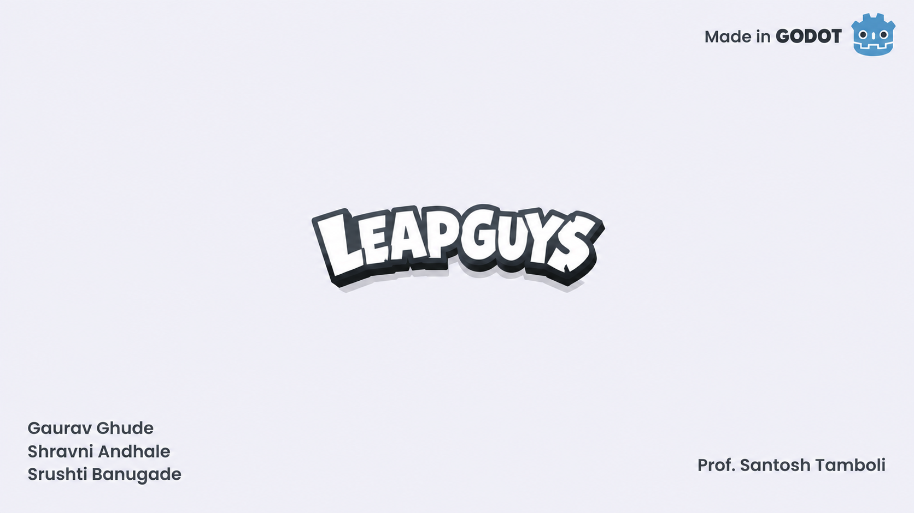
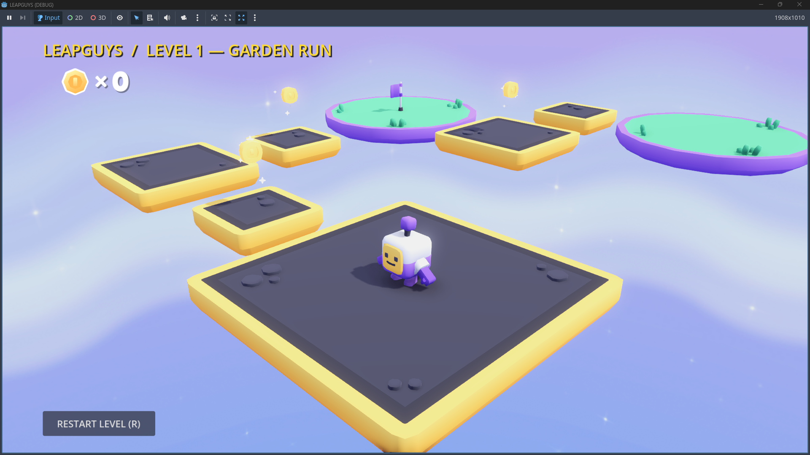

# Leap Guys

<p align="center">
  
</p>

<p align="center">
  <b>A 3D platformer developed using Godot Engine, featuring multi-jump mechanics, moving platforms, collapsing hazards, and progressively challenging levels.</b>
</p>

<p align="center">
  
  
  
</p>

---

## Gameplay Screenshot

<p align="center">
  
</p>

---

## About the Game

**Leap Guys** is a 3D precision platformer focused on responsive movement, multi-jump mechanics, and obstacle-based level design. Players navigate floating platforms, avoid environmental hazards, collect coins, and reach the finish point across five progressively challenging levels.

## Levels Overview

### Level 1 — Garden Run
**Difficulty:** Beginner

Introduces basic movement and jumping mechanics through grass platforms and a straightforward obstacle course.

### Level 2 — Double and Triple Leap
**Focus:** Multi-jump mechanics

Challenges players to cross wide gaps using carefully timed double and triple jumps.

### Level 3 — Drifting Switchbacks
**Focus:** Moving platforms

Features an S-shaped mountain route with platforms moving along the X, Y, and Z axes.

### Level 4 — Falling Trail
**Focus:** Collapsing platforms

Requires players to move quickly across unstable platforms that shake and collapse after contact.

### Level 5 — Sky Ruins
**Focus:** Advanced platforming

Features a 21-platform obstacle course combining triple jumps, moving platforms, and collapsing tiles.

---

## Controls

| Action | Keyboard / Mouse | Gamepad |
| :--- | :--- | :--- |
| Move | W, A, S, D / Arrow Keys | Left Analog Stick |
| Jump / Multi-Jump | Space | A / Cross |
| Rotate Camera | Hold Right Mouse Button and Drag | Right Analog Stick |
| Zoom Camera | Mouse Wheel | Not Available |
| Restart Level | R | Select / Back |
| Release Mouse | Esc | Not Available |

---

## Key Features

- **Responsive Movement and Multi-Jump:** Supports double and triple jumps for navigating complex obstacles.
- **Dynamic Platform Mechanics:** Includes stationary, moving, and collapsing platforms.
- **Checkpoint and Respawn System:** Allows players to resume from designated checkpoints after falling.
- **3D Orbital Camera:** Provides camera rotation and zoom controls for improved spatial awareness.
- **Audio Feedback:** Sound effects accompany jumping, landing, coin collection, and platform collapse.
- **User Interface:** Includes a splash screen, level counter, coin tracker, and victory screen.

---

## Installation and Execution

### Requirements

- Godot Engine 4.x
- Godot 4.2 or later recommended

### Setup Instructions

1. Clone or download the repository:

   ```bash
   git clone https://github.com/GauravG2512/leapguys.git
   ```

2. Open **Godot Project Manager**.
3. Select **Import** and navigate to the downloaded repository folder.
4. Select the `project.godot` file.
5. Click **Import & Edit**.
6. Press **F5** or select the Play button to launch the project.

---

## Project Structure

```text
leapguys/
├── fonts/            # Typography and font resources
├── meshes/           # Custom mesh definitions
├── models/           # 3D characters, platforms, coins, and clouds
├── objects/          # Reusable game objects and scenes
├── scenes/           # Environments and level scenes
├── screenshots/      # Gameplay screenshots and promotional images
├── scripts/          # GDScript gameplay logic
├── sounds/           # Sound effects and audio resources
├── sprites/          # Sprites, shadows, and skybox textures
├── project.godot     # Main Godot project configuration
└── README.md         # Project documentation
```

---

## Technology Stack

- **Game Engine:** Godot Engine 4.x
- **Programming Language:** GDScript
- **Game Type:** 3D Platformer
- **Core Systems:** Character movement, multi-jump mechanics, dynamic platforms, camera controls, checkpoints, and user interface.

## Project Objective

The objective of Leap Guys is to develop an engaging 3D platforming experience that combines precise movement, progressively challenging obstacle courses, and interactive environmental mechanics. The project demonstrates the practical application of game development concepts, 3D scene management, physics-based interactions, and gameplay scripting in Godot Engine.
